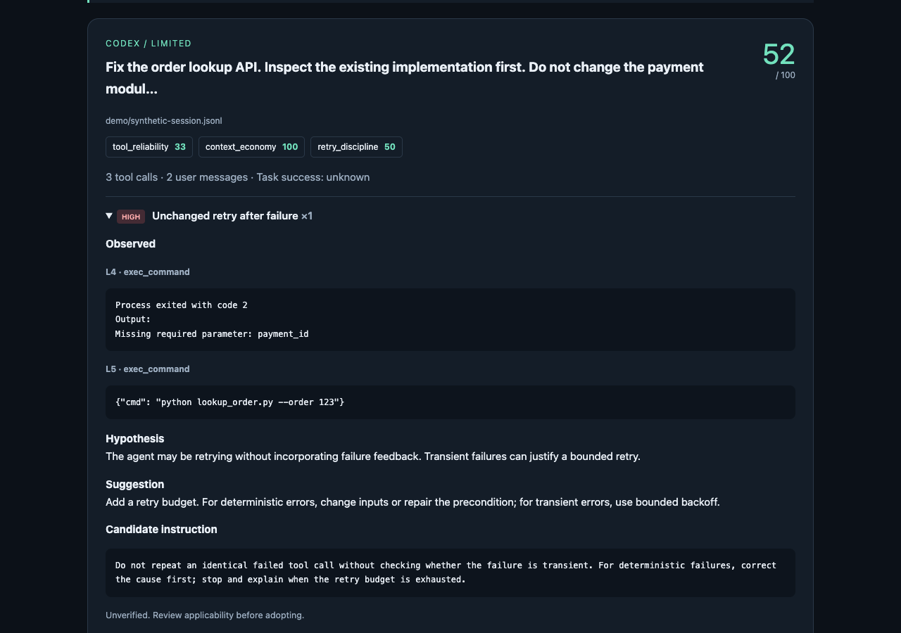

# SessionLens

**Find repeated mistakes in your Codex and Claude Code sessions—locally.**

Local-first diagnostics for Codex and Claude Code sessions. Install once, run from your terminal, and inspect where your agent gets stuck—without exporting or uploading history.

No account. No API key for local diagnostics. No session uploads by default.



[Watch the 25-second demo](docs/assets/demo.mp4) · [Animated walkthrough](docs/assets/demo.gif) · [Share trial feedback](https://github.com/wangjinjie722/sessionlens/issues/new?template=trial-feedback.yml)

*The preview uses a bundled synthetic session. Scores describe observed process signals, not task success. Suggestions have not been replay-tested.*

## Try it without installing permanently

With **Python 3.10+, Git, and [uv](https://docs.astral.sh/uv/)** available, run the synthetic demo without reading your history:

```sh
uvx --from git+https://github.com/wangjinjie722/sessionlens.git@v0.1.1 sessionlens demo
```

Then inspect your five most recently modified local sessions:

```sh
uvx --from git+https://github.com/wangjinjie722/sessionlens.git@v0.1.1 sessionlens scan --limit 5
```

The first run downloads the tool and build dependencies. Session analysis itself stays local. No Git? Install the wheel from [Releases](https://github.com/wangjinjie722/sessionlens/releases/latest) with pipx or pip.

## What it finds

- **Automatic discovery**: read local Codex and Claude Code JSONL sessions without manual imports.
- **Evidence-linked diagnostics**: every finding includes source line numbers, excerpts, a hypothesis, and actionable advice.
- **Transparent scoring**: measure tool reliability, failed retries, and output size without claiming to measure task success.
- **Continuous monitoring**: `watch` analyzes new or changed sessions and updates the report.
- **Optional deep review**: opt in to task-specific model advice through a local or remote Chat Completions compatible endpoint.
- **Local first**: no network requests by default and no third-party runtime dependencies; never modifies agent settings or executes logged commands.

## Install

Requires **Python 3.10+**. Works in macOS/Linux terminals and Windows CMD/PowerShell. The GitHub release includes a wheel and source archive; the package is not published to PyPI.

Recommended, with [uv](https://docs.astral.sh/uv/):

```sh
uv tool install git+https://github.com/wangjinjie722/sessionlens.git
sessionlens
```

With pipx:

```sh
pipx install git+https://github.com/wangjinjie722/sessionlens.git
sessionlens
```

Or clone and install with Python:

```sh
git clone https://github.com/wangjinjie722/sessionlens.git
cd sessionlens
python -m pip install .
sessionlens
```

If your shell cannot find the executable, run `python -m sessionlens` with the Python where you installed it, or run `uv tool update-shell` / `pipx ensurepath` and reopen your terminal. On managed Python installations, use uv, pipx, or a virtual environment rather than system pip. Downloading and installing a release wheel does not require Git.

## Quick start

```sh
# Default: local diagnosis of the 10 most recently modified sessions
sessionlens

# Check sources and installation, without showing credentials
sessionlens doctor

# Preview a synthetic example without reading personal sessions
sessionlens demo

# Inspect just one source / project
sessionlens scan --source claude --limit 5
sessionlens scan --project .

# Standalone, offline HTML report (open the resulting file in your browser)
sessionlens scan --format html --output reports/sessions.html

# Machine-readable output
sessionlens scan --format json --output reports/sessions.json

# Keep watching; only changed snapshots produce output. Ctrl+C stops.
sessionlens watch --interval 10 --format html --output reports/live.html

# Optional explicit path, useful for custom installs and archived transcripts
sessionlens scan --path /path/to/session.jsonl
```

`watch` runs in the foreground; it does not install a startup daemon. HTML reports are static snapshots: refresh the browser after an update. Model calls are intentionally unavailable in watch mode to prevent unbounded background spend.

## What you get

The bundled synthetic demo includes an unchanged retry after a missing-parameter error and a user correction:

```text
[codex] 52/100 · Fix the order lookup API. Inspect the existing implementation first. Do not change the payment module.
  Coverage: limited | Task success: unknown | Tools: 3
  [HIGH] Unchanged retry after failure ×1
    L4 exec_command: Process exited with code 2 ... Missing required parameter
    L5 exec_command: {"cmd": "python lookup_order.py --order 123"}
  [MEDIUM] Tool execution failures ×2
  [MEDIUM] Possible user corrections ×1
```

Each report separates **observations**, **root-cause hypotheses**, **suggestions**, and **candidate instructions**. Candidate instructions are suggestions to review and test, not automatically applied patches. Cross-session aggregation currently groups rule categories, not semantic root causes.

## Deep diagnosis (optional)

Local rules require no API key and generate rule-specific advice. For contextual analysis, use a model endpoint. You explicitly choose the model; no paid model is selected for you.

macOS/Linux:

```sh
export SESSIONLENS_BASE_URL="https://api.openai.com/v1"
export SESSIONLENS_MODEL="YOUR_MODEL_ID"
export SESSIONLENS_API_KEY="YOUR_API_KEY"
sessionlens scan --limit 3 --preview-deep --output reports/context-preview.json
sessionlens scan --limit 3 --deep --format html --output reports/deep.html
```

Windows CMD:

```bat
set SESSIONLENS_BASE_URL=https://api.openai.com/v1
set SESSIONLENS_MODEL=YOUR_MODEL_ID
set SESSIONLENS_API_KEY=YOUR_API_KEY
sessionlens scan --limit 3 --preview-deep
sessionlens scan --limit 3 --deep
```

PowerShell uses `$env:SESSIONLENS_MODEL="YOUR_MODEL_ID"` and the same syntax for the other variables.

A local compatible service can use `SESSIONLENS_BASE_URL=http://localhost:11434/v1` and an installed model supporting JSON output. `OPENAI_API_KEY` is accepted only for `api.openai.com`; custom services require their own `SESSIONLENS_API_KEY` (localhost may omit it). Remote endpoints require HTTPS. Redirects are refused so credentials cannot silently follow a different endpoint.

`--deep` sends **selected, best-effort redacted excerpts** to that endpoint, up to three sessions by default (`--deep-limit`). The model gets the initial task, recent events, and finding neighborhoods within a 24,000-character event budget. It does not get complete session history, files, credentials from agent config, hidden reasoning, or tool execution access. Returned citations must refer to supplied lines. The model may still misinterpret valid evidence; its suggestions are marked unverified. Deep analysis does not alter the deterministic score.

Model advice defaults to English. Use `--language zh` to request Chinese advice. Use `--preview-deep` before sending sensitive sessions. Secret masking is not exhaustive; business content and personal information may remain. The fixed system prompt and payload construction are in [llm.py](src/sessionlens/llm.py).

## Session sources

| Source | Default location | Environment override |
| --- | --- | --- |
| Codex | `~/.codex/sessions/**/*.jsonl` | `CODEX_HOME` (parent of `sessions`) |
| Claude Code | `~/.claude/projects/**/*.jsonl` | `CLAUDE_CONFIG_DIR` (parent of `projects`) |

The adapters read local, observed transcript formats. They are not official SDK integrations. New application versions can change the schema. Cloud-only sessions and other agents require additional adapters. `list` shows paths without opening transcript content. Normal scanning reads the most recent matching sessions, up to `--limit`; project filtering may inspect more files to find matches.

Files are read-only. Symlinked files/directories are skipped. Hidden reasoning, images, system instructions and authentication stores are not collected. Malformed or partially written records are skipped and reported. Limits: 64 MiB/file, 4 MiB/line, 40,000-event soft cap checked between records; truncated reports disclose their limited coverage.

## What the score means

**Observed process quality, not task success.** A score of 100 means no measured penalty in the observed events, not that the output is correct. Sessions without tool results receive `N/A`.

| Dimension | Formula | Weight |
| --- | --- | --- |
| Tool reliability | `100 × (1 − explicit failures / tool results)` | 0.5 |
| Retry discipline | `100 × max(0, 1 − identical failed retries / failures)` | 0.3 |
| Context economy | `100 × (1 − outputs over 12,000 characters / tool results)` | 0.2 |

Each dimension is rounded, then the available dimensions are combined using normalized weights. Retry discipline applies only when calls and failures are present. User-correction matches do **not** affect the score because new requirements or quotations can look like corrections.

Expected failing tests can lower reliability; large outputs may be necessary. `rg`/`grep` with exit code 1 and a simple command is treated as no matches rather than failure. Unknown failure formats may go undetected. See [scoring and limitations](docs/scoring.md).

## Development

```sh
python -m pip install -e .
python -m unittest discover -s tests -v
python -m pip install build
python -m build
```

Tests use synthetic fixtures and mocked model transport. CI runs on Linux, macOS and Windows with Python 3.10, 3.12 and 3.14. Actual provider calls are optional and are not performed by CI. No private sessions belong in fixtures, issues, or commits.

See [architecture](docs/architecture.md), [privacy](docs/privacy.md), and [release instructions](docs/releasing.md).

## Scope of v0.1

Implemented: automatic discovery, local diagnostics, transparent scores, evidence lines, optimization advice, recurring rule patterns, optional model review, watch mode, HTML/JSON/text reports.

Not implemented: arbitrary agent SDK ingestion, causal root-cause proof, automatic harness edits, sandbox task replay, A/B validation, GEPA integration, business-task success scoring. These require task-specific evaluators and replay adapters; historical logs alone do not establish that a suggested fix works.

MIT licensed.

## Help shape the next version

After trying your own sessions, [send a short report](https://github.com/wangjinjie722/sessionlens/issues/new?template=trial-feedback.yml):

1. Did automatic discovery find your sessions?
2. Which finding was useful or incorrect?
3. Did you change anything after reading the advice?

There is no usage telemetry. Feedback is voluntary; never attach private transcripts or unreviewed reports. For installation failures, [open an installation issue](https://github.com/wangjinjie722/sessionlens/issues/new?template=installation.yml).

Demo reproduction steps and ready-to-edit launch drafts are in the [launch kit](docs/launch-kit.md).
